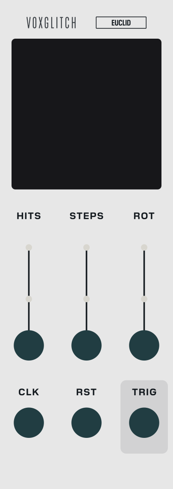

# Euclid - User Manual

## Overview

Euclid generates Euclidean rhythms: patterns where a handful of hits are spread as evenly as possible across a number of steps. Those spacings underpin clave, bell and folk rhythms the world over, and a tiny change to any of three numbers can swing a groove from steady to wonderfully lopsided.

Set how many **HITS** you want and how many **STEPS** to spread them over, and Euclid distributes the hits as evenly as the maths allows. The ring on the panel shows the result as a circle of lit and dark slots with a playhead sweeping around it. Each clock pulse advances one step; landing on a lit slot fires the outputs. **ROT** turns the whole pattern under the playhead, sliding the accents to a different part of the bar without changing the rhythm's shape. All three have CV inputs with attenuverters, so the rhythm can morph while it runs. It is 8 HP, mono, and has no clock of its own.

## Quick Start

1. Add Euclid to your patch
2. Patch a clock into **CLK**, one pulse per step (sixteenths for a sixteen-step bar), and the clock's reset output into **RST**
3. Patch **TRIG** into a drum voice
4. Start the clock. Euclid arrives at 4 hits over 16 steps, so you get four evenly spaced hits per bar
5. Turn **HITS** up for a busier pattern and **STEPS** for a longer or shorter bar. Turn **ROT**, or drag around the rim of the ring, to move where the hits fall

To take it further:

- Patch a slow LFO into the **ROT** CV jack, then turn the small attenuverter above that jack away from its centre. A cable on its own does nothing until you do.
- Right-click the module to choose a longer **Trigger length** if the module you are driving wants a wider pulse.

## Controls

- **HITS** - How many of the steps are hits, 0 to 32. Raise it to fill the bar, drop it for sparse, syncopated grooves. Hits are clamped to the step count, so more hits than steps is simply every step. At 0 nothing plays.
- **STEPS** - The length of the cycle before it repeats, 1 to 32. If you shorten it below the step Euclid is standing on, the next clock wraps to step 1.
- **ROT** - Rotates the pattern, 0 to 31, one step per click. Every step of rotation moves the hits one slot earlier in the cycle, which is one slot counter-clockwise on the ring; the rhythm's shape never changes, only where it starts. Values past the step count are held at the last step, so on eight steps ROT 7 and everything above it give the same pattern; dragging the ring's rim wraps within the step count instead. The ring's rim is a second way to set it (see "The Ring").
- **HITS CV / STEPS CV / ROT CV attenuverters** - The three small knobs above the CV jacks, -100 % to +100 %. Each one scales its CV jack before the voltage reaches the knob. **They start at 0, and at 0 the jack is ignored: a patched CV cable does nothing until you turn its attenuverter up.** Turn right to add the CV, left to invert it. This is how you dial in exactly how far a modulation source bends each parameter.

## The Ring

The dark disc in the middle of the panel is the pattern Euclid is playing right now, knobs and CV combined, so what you see is what the outputs are doing even while a CV is bending the numbers. The knobs themselves stay where you left them.

- The dots run clockwise from 12 o'clock, one per step, with a short tick outside the ring marking step 1. A filled dot is a hit; a hollow one is a rest.
- The white ring is the playhead: the step that is current now.
- The readout in the centre shows the effective hits over steps, with the rotation underneath.
- **Drag around the rim** to rotate the pattern. Dragging clockwise moves the dots clockwise, one step at a time, and it is the ROT knob you are turning: the knob follows, and the drag is one undo step.
- **Double-click** the ring to set the rotation back to 0.
- A right-click on the ring opens the module's ordinary menu.

## Inputs

- **CLK** - Clock. Each rising edge advances the pattern by one step; a hit step fires TRIG. An edge counts when the line reaches 2 V, and the line must fall back to 0.1 V before the next edge counts. There is no internal clock, so nothing moves until a pulse arrives, and a clock that stops leaves Euclid where it is. Edges arriving within 1 ms of a reset are ignored (see "Reset and the First Step").
- **RST** - Reset. A rising edge puts Euclid on step 1 and plays it at once. See "Reset and the First Step" for what happens in each situation.
- **HITS CV / STEPS CV / ROT CV** - Voltage control over the three knobs, through the matching attenuverter. With the attenuverter fully up, each volt is worth about three steps: 1 V moves the value by 3, 5 V by 16, and negative volts move it down. Fractions are dropped, and the result is clamped to the knob's range, so a CV can never push HITS past the step count or ROT outside the cycle. The value that plays, and that the ring shows, is the knob plus the CV; the knob does not move. Remember that the attenuverters sit at 0 when the module is new, so a cable in one of these jacks is silent until its attenuverter is turned up.

## Outputs

- **TRIG** - A 10 V pulse each time the playhead lands on a hit. It is 1 ms long by default; **Trigger length** in the right-click menu goes up to 200 ms. Every hit gets its own rising edge: if a new hit lands while the previous pulse is still high, the output drops to 0 V for one sample first, so a fast clock never merges two hits into one long pulse. It is Euclid's only output: for a sustained gate, run TRIG into an envelope or a gate-length utility.

## Reset and the First Step

Euclid follows the VCV Rack voltage standard for clock and reset, which is the behaviour of VCV's own SEQ3, Impromptu Clocked and every sequencer written to the standard. In plain words:

- **A reset puts Euclid on step 1 and plays it.** If step 1 is a hit, TRIG fires at the instant of the reset. The next clock is step 2. This holds even when Euclid was already sitting on step 1: a reset always plays it again. (VCV's SEQ3 stays silent in that one case; Impromptu's sequencers fire, and so does Euclid.)
- **Clocks arriving within 1 ms of a reset are ignored.** The standard asks for this because a clock pulse that travels through one more module than the reset pulse arrives a sample later, and without the window it would push the sequencer straight on to step 2. A clock on the same sample as the reset is swallowed too: step 1 plays once, at the reset.
- **A clock master that sends a reset when it starts plays step 1 on that start.** Impromptu Clocked does this by default, and it deliberately sends no clock edge at the start, because it expects the reset itself to have played step 1. Euclid does exactly that, so it lands on the downbeat with SEQ3 and the rest of the patch, after a stop-reset-run and after a reset pressed mid-bar alike.
- **A reset that arrives one sample after a clock** (the clock patched straight in and the reset through a utility module) plays the clock's step and then step 1 a sample later: two hits. That is the standard's known limitation, and SEQ3 does the same. Delay the clock and the reset by the same amount and it goes away.
- **When a patch loads, Euclid is already on step 1** (the ring shows it), but nothing fires; **Initialize** in the right-click menu leaves it the same way. So the first clock after loading plays step 2, unless a reset arrives first. Patch your clock's reset into RST and it will.

Patch **CLK** and **RST** from the same clock master and every reset lands on the downbeat.

## Right-Click on the Panel

- **Trigger length** - The length of the pulse at TRIG: 1, 2, 5, 10, 20, 50, 100 or 200 ms. The default 1 ms is the standard for triggers and is all a drum module needs; pick a longer one for a module that wants a wider pulse. Whatever the length, every hit still gets its own rising edge. The setting is saved with the patch.

## Tips

- Coprime settings like 5 hits over 16 steps, or 3 over 8, give the richest, least repetitive patterns; even divisions feel four-on-the-floor.
- Modulate **ROT** with a slow LFO, patched into the ROT CV jack with its attenuverter turned up a little, to let the accents drift around the bar while the underlying rhythm holds steady. Watch the ring: it shows the pattern moving.
- For polyrhythms, run several Euclids from clock dividers, or give each a different **STEPS** on the same clock: 16 against 12 against 7. Feed every one of them **CLK** and **RST** from the same master and they stay locked, and every reset brings them all back to step 1 together.
- **TRIG** into a drum and, from the same jack, into an envelope on a pad gives you a kick and a chord stab that always agree. Set **Trigger length** longer if the envelope wants a gate rather than a tick.
