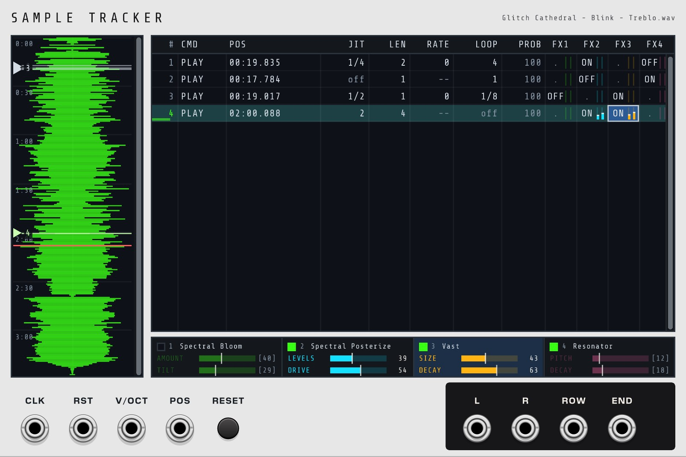
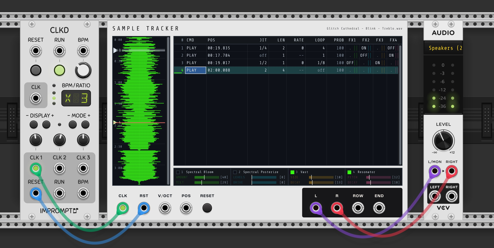
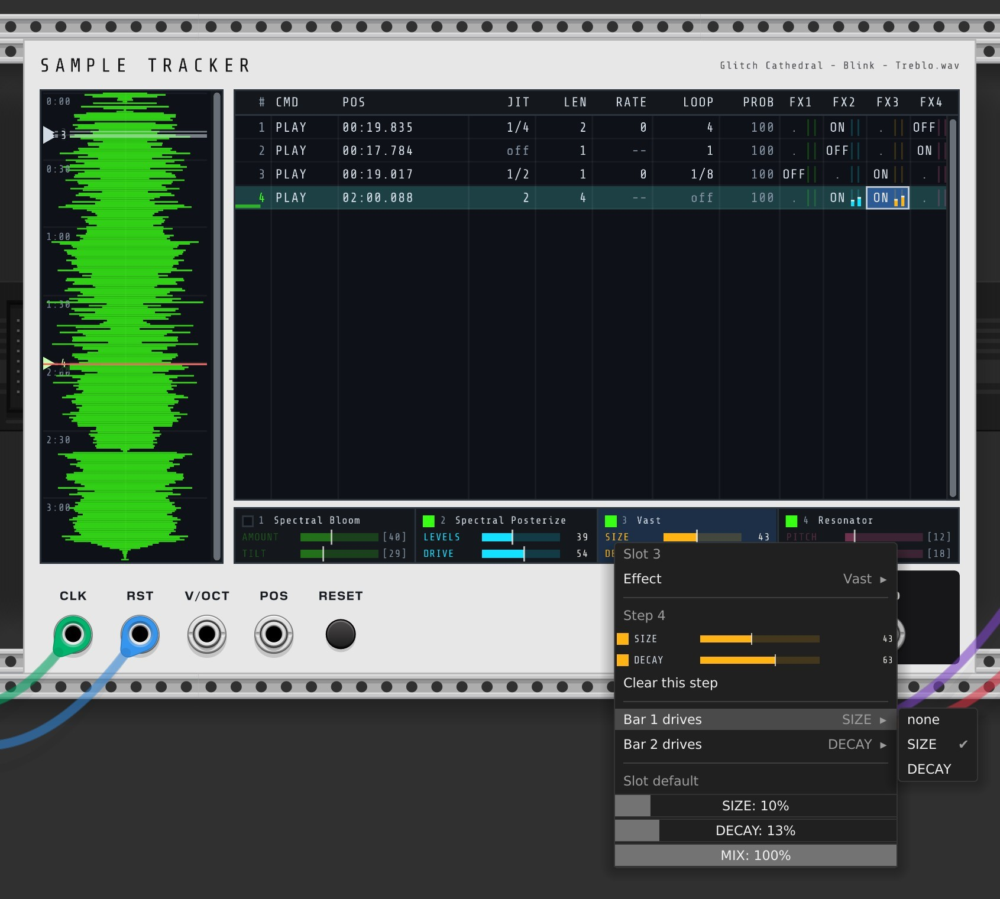

# Sample Tracker - User Manual

## Overview

Welcome to the Voxglitch Sample Tracker user manual!  Sample Tracker is a sample player plus a scripting language in the style of old-school trackers.  It allows you to sequence playback within a sample.  This is useful for glitchy, IDM style music, where you're looking to capture the unique sound of a skipping CD player put into a microwave oven while you're on nitrous. (Please don't try that.)

I comes with a large number of effects that may also be sequenced.

## Quick Start

1. Add Sample Tracker to your patch
2. In the module's context window, right-click and choose Load sample.  Samples that are between 30 seconds and a few minutes work best.
3. Click anywhere in the grid, then press Ins four times to make four rows.  You can also right click on the grid and select Insert Row
4. Click the first row’s POS cell, then click a spot on the waveform to set that row’s start position. Repeat for the other rows
5. Patch a clock into CLK
6. Patch L and R to your audio interface

The script plays from row 1 on the first clock edge and repeats when it runs off the last row. Each row lasts four clock steps until you change its LEN.

There are a lot of ways to interact with the grid, from typing in values directly, to clicking on a cell and using the mouse wheel, to right-clicking and selecting values that way.  My hope is that whatever you think would work, works, and please reach out if you have any clever user-experience hacks that you'd like added.

Here are a few more quick tips, just in case you want to jump in without reading the rest of this manual:

* It's possible to multi-select and copy/paste rows.  
* There are four effect slots.  Selecting and adjusting effects is done by right-clicking one of the four effects sections underneath the main tracker table.  Enabling or disabling effects is done through the FX1, FX2, FX3, and FX4 columns in the tracker table.

# Inputs and Outputs

## Inputs

- CLK (gate/trigger): Clock input is required for stepping through the tracker's sequencer.  
- RST (gate/trigger): Rearms the script to row 1, fades the audio, turns all four FX slots off
- V/OCT (1V/oct): (optional) Controls pitch.  In practice, a row's RATE is probably the more typical way of controlling a sample's pitch.  The v/oct input, which is added to the RATE, might be useful for transpositions.
- POS (0–10V): (optional) The POS input is helpful if you want add slow variation of the module's sound, which otherwise might start to sound repetative.  Typically the playback position is controlled via each row's POS value.

## Outputs

- L: Left audio. In Multichannel mode this becomes a polyphonic cable carrying every channel of the file.
- R: Right audio (channel 2). Mono files play on both L and R.
- ROW: 10V trigger when a PLAY, REV or SIL row starts.
- END: 10V trigger when an END row runs, and when the script wraps off the bottom back to row 1.

## The RESET button

Manual reset.

## Loading a sample

Drop WAV, AIFF (.aiff/.aif) or MP3 onto the module, or right-click the module and choose Load sample.... Reopening a patch reloads the saved file path. Unload sample clears audio.

## Waveform and navigation

The waveform runs top-to-bottom to keep the panel compact. Overlays:

- Time ruler at left
- Markers for PLAY/REV rows that hold positions (triangle, horizontal line, and row number)
- Loop band (amber) for the currently looping row
- Playhead (red) while the script plays

Navigation:
- Wheel: zoom in/out around the pointer
- Middle-drag or scrollbar: pan
- Click scrollbar track: page up/down

## Setting positions

- Click anywhere on the waveform to set the selected row’s POS (PLAY/REV only).
- Drag a marker to move that row’s position. Dragging a marker also selects its row.
- Hold a dragged marker at the top/bottom edge to auto-scroll.

Positions are absolute file frames. Loading a different sample keeps your row numbers and times; markers will land wherever those times are in the new file. Positions past the end of a shorter file simply play from its last frame.

## Row types

- PLAY: Play forward for LEN clock steps. Starts at POS, or continues from the current playhead if POS is blank.
- REV: Same as PLAY, but reverse sample playback.
- SIL: Silence for LEN steps; the playhead is held.
- JUMP: Jump to another row. Costs no clock time and does not fire ROW.
- END: Stop playback and ignore CLK until a reset.

## Columns

- #: Row number (display only)
- CMD: PLAY, REV, SIL, JUMP, or END
- POS: Start position as mm:ss.mmm. On a JUMP row this shows the target, as -> 3
- JIT: Random scatter on the start position (off, 1/4, 1/2, 1, 2, 4 steps)
- LEN: How many clock steps the row lasts. On a JUMP row: jump count, shown as x2
- RATE: Pitch/speed offset in semitones (-24 to +24). Blank keeps current rate
- LOOP: Repeating window (off, 4, 2, 1, 1/2, 1/4, 1/8, 1/16 steps)
- PROB: Percent chance the row happens at all (0–100)
- FX1 to FX4: Per-row control for effect slots 1–4 (Keep/ON/OFF plus two value bars)

Blanks: POS and JIT are blank on SIL and END rows; JIT is also blank on JUMP rows (where POS shows the target and LEN the jump count); LEN is blank on END rows.

Dim values mean “do nothing here” (keep). For example, a dim POS is “continue,” a dim RATE is “keep the current rate,” a dim PROB of 100 means “always,” and a dim “.” in an FX cell means “keep.” A JUMP with -> ? points to a deleted row.

While playing, the active row is tinted, and a small meter under “#” shows remaining steps.

## Editing a cell

- Click a cell to select it and give the grid the keyboard.
- Type, then Enter to commit or Escape to cancel. Pressing Enter on a non-editing cell opens it with its current text.
- Press + or - to step the value, or use the mouse wheel
- Backspace/Delete clears to the column’s default.

### Typing a position

POS accepts:
- m:ss.mmm (1:23.500)
- seconds (23.5)
- raw frame count (103635) when there’s no dot or colon
(But remember that you can click on the waveform to set the position as well.)

On a JUMP row, type the target’s row number.

## Selecting rows

The selection is a range of rows plus one cursor column. The cursor cell is what keys edit (and what the waveform follows); the range is what row operations and multi-row writes act on.

- Click a cell to collapse the range to that row
- Shift+click a row extends the range
- Shift+Up/Down/Home/End/Page Up/Page Down extend the range. Shift has no effect on Left, Right or Tab, which always move the cursor column and collapse the range to one row
- Ctrl+A selects all rows

Using (+/-) on a cell affects all selected rows.  So, for example, if you have four rows selected and have the LEN cell active, pressing + will increment the LEN value for all four selected rows.

## Rows and blocks

- Ins: Insert one row after the selection
- Ctrl+D: Duplicate the selected rows
- Ctrl+Del: Delete the selected rows
- Ctrl+Up/Down: Move the selected rows up/down

Duplicate/paste create new rows. If a copied block contains a JUMP, the copy’s JUMP retargets to the copied row so copied loops remain self-contained. The script holds at most 256 rows.

## Copy and paste

You can cut, copy, and paste single cell or entire rows.
- Ctrl+C / X / V copy/cut/paste cells (the cursor column across the selected rows)
- Ctrl+Shift+C / X / V copy/cut/paste whole rows
 

## Cell right‑click menus

Right-clicking on a cell opens a context menu where cell information can be editied.  This is a redundant way of editing cell information, which can also be done more directly with the keyboard, or using the plus and minus keys.

## Lock Editor

In order to lock the editor to prevent mis-clicks during a performance, you can right-click on the module's panel (outside of the "digital" areas), then select the "Lock Editor" context menu item.

# The Sequencer

Let's dive in and look at each sequencer column.

## CMD

The value of CMD specifies the command to run when playback reaches the row.  Here are the available options:

* PLAY: Playback as normal
* REV: Playback the audio in reverse
* SIL: Be slient.  No playback.
* JUMP: Jump to a new position in the sequence.  ("GOTO", for old school programmers)
* END: Stop playback

## POS

The position to jump to in the sample when playback reaches the row.  It's noteworthy that this can be cleared using the delete key, and the playback position won't change in that situation.

## JIT

Jitter offset of the POS.  This adds some randomization to the playback position.

## LEN

LEN is how long the row lasts. It counts clock steps. A row with LEN 4 holds for four clock edges, then the next row starts.

## RATE

Essentially pitch.

## LOOP

LOOP repeats a slice of the audio until LEN runs out.  The value of loop controls how long the slice is that repeats.

# Effects

The Sample Tracker has a large variety of effects that can be automated using the tracker sequencer.  There are four sample "slots", meaning that you can have 4 samples running in series at a time.  Each row of the tracker sequencer has four effect cells labeled FX1 through FX4.  These cells are used to enable or disable an effect for that row in the sequence.

Row FX cell options are:
- . (dim): This means, don't turn on or off an effect.  Just keep it as-is.
- ON: Enable the effect
- OFF: Disable the effect.

The four effects slots directly under the main sequencer are used to select which effect is assigned to the slot, and select the parameters for the effect (which vary depending on effect).

## Choosing an effect

Right-click (or left-click) a slot cell to open its context menu. Under Effect, select the effect to assign to the slot, or choose None.

## The two value bars

Each FX cell also carries two narrow bars (Bar 1 and Bar 2), each mapped to one named parameter of that slot. 

# Keyboard Reference

The grid takes the keyboard once you click a cell. The cursor cell’s ring turns green when it has focus.

## Moving

| Key | Action |
|-----|--------|
| Up / Down | Move the cursor one row. Clamps at the ends. |
| Left / Right | Move the cursor one column. Clamps at the ends. |
| Tab / Shift+Tab | Move one column, wrapping to the next or previous row |
| Home / End | First row / last row |
| Page Up / Page Down | Move by one screen of rows |
| Shift + Up, Down, Home, End, Page Up or Page Down | Extend the selected row range instead of collapsing it. Shift has no effect on Left, Right or Tab, which always move the cursor column and collapse the range to one row. |
| Ctrl+A | Select every row |

## Editing

| Key | Action |
|-----|--------|
| 0 to 9 | Start typing in POS, LEN, RATE and PROB |
| . and : | Accepted inside a position (mm:ss.mmm) |
| . | Also accepted inside an FX cell, to separate the two bar values (62.30) |
| - while typing | Flip the sign, on RATE only |
| Enter | Commit what you typed, or open the cell with its current text |
| Escape | Cancel what you typed |
| Backspace / Delete | Delete a character while typing; otherwise clear the cell to its default |
| + or = | Step the cell up, across every selected row |
| - | Step the cell down, across every selected row |

## Column shortcuts

| Key | Where | Action |
|-----|-------|--------|
| p / r / s / j / e | CMD | Set PLAY, REV, SIL, JUMP or END (lowercase) |
| 1 | An FX cell | Turn that slot ON |
| 0 | An FX cell | Turn that slot OFF |
| ] / [ | An FX cell | Raise or lower the first value bar by 5 |

## Rows and clipboard

| Key | Action |
|-----|--------|
| Ins | Insert a row after the selection |
| Ctrl+D | Duplicate the selected rows |
| Ctrl+Del | Delete the selected rows |
| Ctrl+Up / Ctrl+Down | Move the selected rows up or down |
| Ctrl+C / Ctrl+X / Ctrl+V | Copy, cut and paste cells |
| Ctrl+Shift+C / Ctrl+Shift+X / Ctrl+Shift+V | Copy, cut and paste whole rows |
| Ctrl+Z | Undo (Rack’s own) |

## Mouse

| Action | Result |
|--------|--------|
| Wheel over the selected cell | Step that cell’s value |
| Shift + wheel over a selected FX cell | Step that slot’s first value bar by 5 |
| Wheel anywhere else in the grid | Scroll the list |
| Wheel over the waveform | Zoom |

# Exporting and Importing scripts

The tracker sequencer's data can be exported and imported as JSON using the main module's context menu.  I added this mostly to make it easy to collaborate with an LLM to create larger tracker sequences.

