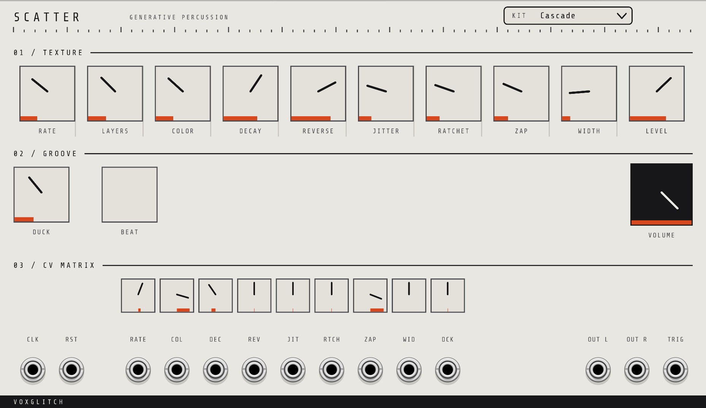
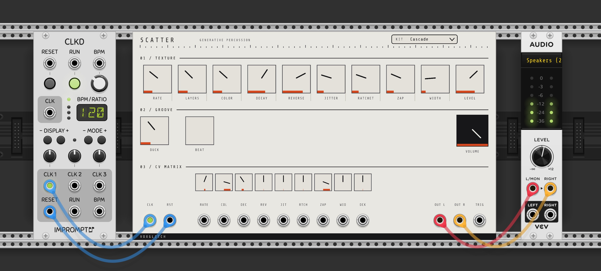

# Scatter - User Manual

## Overview

Scatter is a generative percussion and texture instrument for VCV Rack. It's closer to a musical toy than a modular building block.  If you're looking for a flexible module that allows you to explore deep sonic worlds, this is not it.  It's more Yodeling Pickle, less Arturia MatrixBrute.  

You choose a Kit, turn dials, feed it a clock, and embrace the weird.

Scatter has eighteen kits, spanning noise grit, struck metal, combed plucks, chord instruments, choirs, dub stabs, FM chatter, rain, drum membranes, gamelan, birdsong, bytebeat and melodic lead lines. It follows an external clock at one pulse per beat. Stereo audio is available at **OUT L** and **OUT R**, and a per-beat trigger is available at **TRIG**.

## Quick Start

1. Add Scatter to your VCV Rack patch
2. Patch a clock into the **CLK** input. One pulse per beat.
3. Patch **OUT L** and **OUT R** to your audio interface
4. Start the clock. Nothing happens on the first pulse. Sound starts on the **second** pulse.
5. Click the **KIT** pill at the top right and choose a kit
6. Turn **RATE** and **LAYERS** to set how busy it is

The **BEAT** lamp flashes once per beat while Scatter is running. If the lamp is dark, Scatter has no usable clock and will be silent.

To take it further:

- Right-click the module and choose **New seed** until you like what it plays
- Patch **TRIG** into your own kick drum, then turn **DUCK** up to make room for it
- Turn **RATCHET** up from zero for rolls and flams
- Patch an LFO into a **CV MATRIX** jack, then open the small attenuverter directly above that jack. A cable on its own does nothing until you do.

## Deep Dive

There isn't really a deep dive.  It's more ... try things out and you'll get the hang of it. :-)