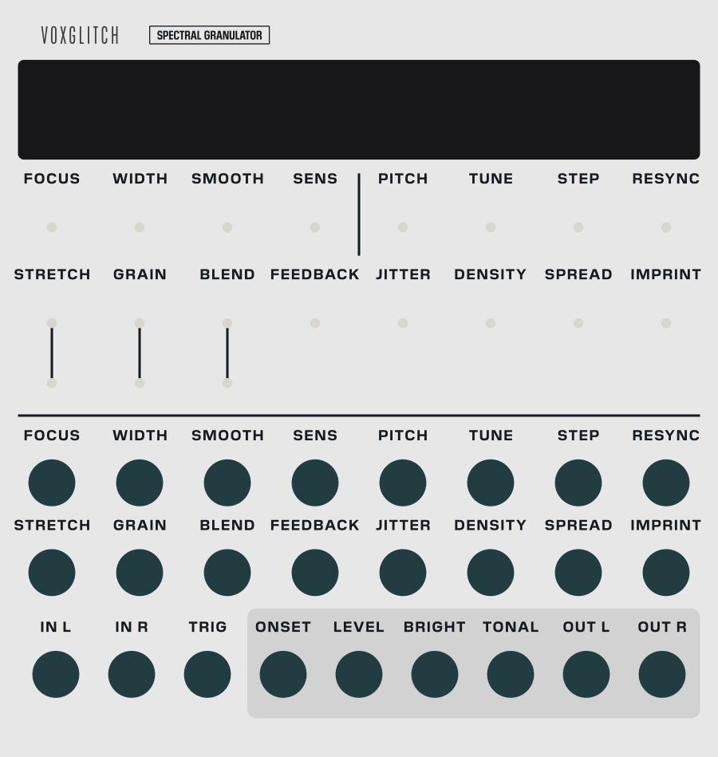

# Spectral Granulator - User Manual

## Overview

Spectral Granulator is a granular smear that listens to what it is smearing. One half of the module analyses the incoming sound and reduces it to four signals: an **ONSET** trigger on every hit or note start, and **LEVEL**, **BRIGHT** and **TONAL**, three slow voltages that follow how loud, how bright and how pitched the sound is. The other half is a grain engine that stretches, steps, re-pitches and layers the same sound. The four signals are wired into the grain controls, so the sound steers its own treatment: hits can snap the smear back to the present, loud passages can stretch while quiet ones run in real time, and pitched material can be smeared while noise passes through untouched.

Every knob has a CV input, and the four analysis signals have their own outputs, so anything can be overridden or patched somewhere else. It is 24 HP, stereo in and out (mono in gives a stereo smear).

The dry signal is delayed by about 21 ms (1024 samples), so the analysis lines up with the audio it steers.

## Quick Start

1. Add Spectral Granulator and patch a sound into **IN L** (and **IN R** if it is stereo). Patch **OUT L** and **OUT R** to your mixer
2. You should hear a 4x smear of the input. Turn **STRETCH** to make it longer or shorter and **GRAIN** to change its texture
3. Turn **RESYNC** fully up. Now every hit the module detects pulls the smear back to the present, so the smear follows the rhythm. Watch the bar under the spectrum: when it crosses the white tick, an onset fires. Turn **SENS** until it fires where you want
4. Turn **RESYNC** back down, set **STRETCH** fully left, and turn the small knob under **STRETCH** fully right. Loud moments now stretch and quiet ones do not
5. Turn **BLEND** fully left and the small knob under it fully right. Only pitched material is sent to the grains; noisy material (consonants, hats, breath) passes straight through

To take it further:

- Choose a **PITCH** set and turn **STEP** up for a stepped, mechanical smear.
- Turn **GRAIN** all the way down. Below about 10 ms the grains stop sounding like a smear and become a buzz or a comb with a pitch of its own.
- Turn **FEEDBACK** up so the smear feeds itself and hangs on after the input stops. With **PITCH** on Oct up, each pass climbs an octave.
- Turn **JITTER** up to loosen the orderly smear into a cloud.
- Turn **IMPRINT** up so the smear takes on the spectral shape of what is playing right now.
- Narrow **WIDTH** and move **FOCUS** to make the analysis listen to one part of the spectrum only: the kick, the hats, a voice.

## The Display

- **The spectrum** of the input, low frequencies on the left. The bright part is the band the analysis is listening to, set by **FOCUS** and **WIDTH**; the dim part is ignored.
- **The bar underneath** is the onset detector. The white tick in the middle is its threshold. When the bar crosses the tick an onset fires and the bar flashes. **SENS** moves the threshold, so turning it up makes the same material reach further.
- **L, B and T** on the right are the LEVEL, BRIGHT and TONAL signals, as they leave their output jacks.

## Controls

The four knobs left of the rule set up the analysis:

- **FOCUS** - The centre of the band the analysis listens to, 20 Hz to 20 kHz.
- **WIDTH** - How wide that band is, from a tenth of an octave to ten octaves. Fully right, it is the whole spectrum and FOCUS has no effect. A very narrow band low down is only a bin or two wide, so the signals from it are coarse.
- **SMOOTH** - How quickly LEVEL, BRIGHT and TONAL move, 2 ms to 10 s. It also sets how long IMPRINT holds on to a spectral shape after the input lets go of it.
- **SENS** - Onset sensitivity. Drums and busy material trigger readily at the middle; sustained material such as a sung vocal, flutes or pads needs it turned up.

The rest shape the grains. Top row:

- **PITCH** - The set of intervals the grains cycle through, in order: Unison, Oct down, Oct up, Octaves, Fifths, Five, Minor, Major.
- **TUNE** - Transposes every grain, 24 semitones either way. Each grain takes the tuning that is set at the moment it starts.
- **STEP** - Fully left it is off and the grains move smoothly through the sound. Turned up, the grains re-read one spot for the step time (1 ms to 2 s) before moving on. Long steps give a stuttering, mechanical repeat; steps of a few milliseconds turn into a pitched buzz.
- **RESYNC** - The chance that a trigger pulls the grains' read position back to the present. At 0 % that only happens when the position has fallen 8 seconds behind (and then on the next trigger, so it lands on a hit). At 100 % every trigger does it. The trigger is ONSET unless something is patched into TRIG.

Bottom row:

- **STRETCH** - How much the sound is slowed, 1x to 128x. The grains read from a position that falls further behind the live input the longer the stretch runs. At 128x the position barely moves, so the smear is all but frozen until the next resync.
- **GRAIN** - Grain length, 1 ms to 1 s. Long grains are smooth and blurred. Below about 10 ms the grains follow each other so quickly that their rate becomes a pitch: the smear turns into a buzz, a comb or a robotic tone, and GRAIN tunes it.
- **BLEND** - How much of the input is sent to the grains; the rest passes straight to the output. Because it works on what goes *in* to the grains, grains that are already sounding ring out when you turn it down. At high STRETCH that tail can last several seconds.
- **FEEDBACK** - Feeds the grains' output back into the grains, 0 to 110 %. The smear regenerates: it hangs on after the input stops, and with a PITCH set or TUNE each pass is transposed again. Past 100 % it builds until an internal limiter holds it, and it will go on sounding with no input at all. Turn it down to let it die away.
- **JITTER** - Each grain reads from a random distance further back, up to 2 seconds, and the grains' timing is loosened. At zero the smear is orderly and mechanical; turned up it becomes a cloud, and short grains lose their buzz and turn to noise.
- **DENSITY** - How many grains overlap, from 0.25 to 16. Below 1 there are silent gaps between grains; high values are thick.
- **SPREAD** - Stereo width of the grains, from mono to hard left and right.
- **IMPRINT** - Re-shapes the grains toward the spectral shape of the live input. At 100 % the smear "says" what the input is doing now, like a vocoder whose carrier is the smear. When the input goes quiet, so does the smear, after the SMOOTH time.

The **three small knobs** under STRETCH, GRAIN and BLEND are steering amounts, -100 % to +100 %. Each one sets how far its CV jack moves the knob above it, and with nothing patched in that jack the source is an analysis signal: **LEVEL** for STRETCH, **BRIGHT** for GRAIN, **TONAL** for BLEND. **They start at 0**, so Spectral Granulator is a plain smear until you turn one up. Turn right for more of the knob when the signal is high, left for less.

## Inputs

- **IN L / IN R** - Audio. IN R is normalled to IN L.
- **TRIG** - A trigger that resyncs the grains, with the chance RESYNC sets. With nothing patched it receives ONSET. Patch a clock here to resync on the beat instead.
- **The two rows of CV jacks** - One for every knob, in the same position as its knob. 10 V covers a knob's full travel and the voltage adds to the knob's setting; negative voltages subtract. On the PITCH jack, 10 V sweeps all eight sets. The **TUNE** jack is the exception: it is 1 V/oct, so a keyboard or sequencer plays the grains in tune.
- **STRETCH, GRAIN and BLEND CV** go through the small steering knobs described above, so a cable in one of these three does nothing until its small knob is turned up. Patching a cable replaces the analysis signal that jack normally receives.

## Outputs

- **ONSET** - A 1 ms, 10 V trigger each time the detector fires.
- **LEVEL** - 0 to 10 V: loudness inside the band. About 0 V at -50 dB and 10 V at -6 dB.
- **BRIGHT** - 0 to 10 V: where the energy in the band sits, low to high.
- **TONAL** - 0 to 10 V: 0 V is noise, 10 V is clearly pitched.
- **OUT L / OUT R** - The direct signal and the grains.

The four analysis outputs work on their own, with nothing else patched: Spectral Granulator can be used as an onset detector and envelope, brightness and tonality follower for other modules.

## Tips

- For vocals, turn **SENS** up to around 75 %, set **BLEND** fully left with its small knob fully right, and add **IMPRINT** to taste: consonants stay crisp while vowels smear.
- For drums, narrow **WIDTH** and put **FOCUS** on the kick with **RESYNC** at 100 %: only the kick pulls the smear back.
- Patch **LEVEL**, **BRIGHT** or **TONAL** into a different CV jack than the one it is normalled to, for example TONAL into IMPRINT.
- For a shimmer, set **PITCH** to Oct up, **FEEDBACK** around 70 % and **STRETCH** around 2x, and add a little **JITTER**.
- Patch a sequencer's 1 V/oct output into the **TUNE** jack to play a melody on the smear.
- IMPRINT with a long SMOOTH is noticeably louder than without, and FEEDBACK past 100 % sustains at a steady loud level; turn your mixer down first.
